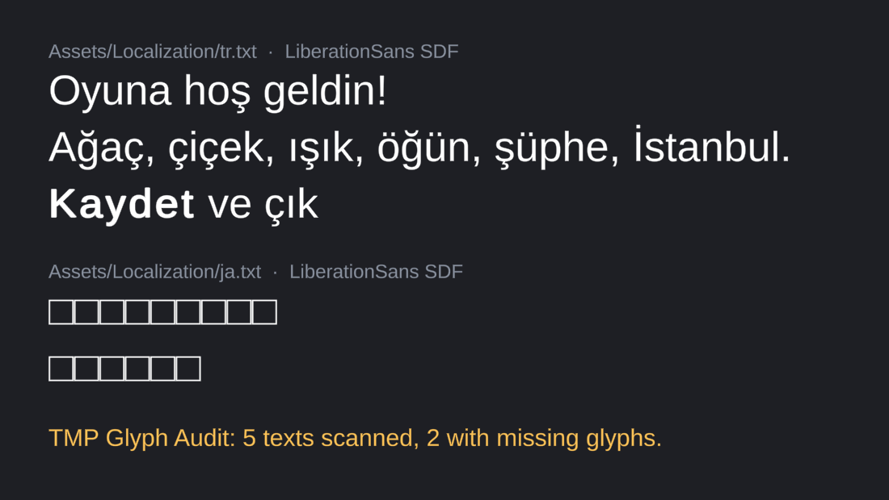

# TMP Glyph Audit

[](https://openupm.com/packages/com.rizgarozan.tmp-glyph-audit/)
[](https://github.com/RizgarOzan/tmp-glyph-audit/actions/workflows/tests.yml)
[](#install)
[](LICENSE)

Finds every TextMeshPro text your fonts can't draw, before a player sees the empty boxes.

TMP only warns about a missing character when that text is rendered, which is how a Turkish `ğ` or a Japanese menu ships as `□□□`. This package checks the whole project at once, in the editor or in CI: every `TMP_Text` in scenes and prefabs, runtime text files (localization exports, dialogue) against the font that will show them, and Unity Localization string tables if `com.unity.localization` is installed. Characters go through TMP's own fallback chain (font, its fallbacks depth first, TMP Settings global fallbacks, default font); dynamic fonts count a character their source file has. Font assets are never modified.



*The test project's two sample files drawn with LiberationSans SDF and its fallback (Unity 6000.3), rendered by `unity/Assets/Editor/ReadmeImage.cs`. The text report:*

```
TMP Glyph Audit: 5 texts scanned, 2 with missing glyphs.

Assets/TextMesh Pro/Resources/Fonts & Materials/LiberationSans SDF.asset is missing 15: U+3046 'う', U+3053 'こ', …
  Assets/Localization/ja.txt > line 1: うこそへよゲムー！
  Assets/Localization/ja.txt > line 2: して了保存終
```

## Install

Unity 2023.2 or newer (TMP inside `com.unity.ugui` 2.0). From [OpenUPM](https://openupm.com/packages/com.rizgarozan.tmp-glyph-audit/):

```
openupm add com.rizgarozan.tmp-glyph-audit
```

or Package Manager > + > Add package from git URL:

```
https://github.com/RizgarOzan/tmp-glyph-audit.git?path=/packages/com.rizgarozan.tmp-glyph-audit
```

## Use

Open Window > Text > TMP Glyph Audit, pick folders, tick scenes and prefabs, add runtime text files (folder, pattern, font) and press Scan. For Unity Localization add a locale/font pair; findings name the `StringTable` and entry key. The Localization package is optional.

Results are grouped by font. Export characters… writes the missing set to a `.txt` for the Font Asset Creator (Character Set > Characters from File). Settings live in `ProjectSettings/TmpGlyphAuditSettings.json`, shared with CI.

### CI

```bash
Unity -batchmode -nographics -projectPath . \
  -executeMethod RizgarOzan.TmpGlyphAudit.Editor.GlyphAuditCli.Run \
  -glyphAuditReport Logs/tmp-glyph-audit.txt
```

Exit code `0` means every character can be drawn, `1` means glyphs are missing, `2` means the scan failed. A `.json` report path gives structured output. `-glyphAuditAnnotations` adds a GitHub Actions `::error` per finding.

`-glyphAuditSettings path/to/settings.json` uses another settings file, relative to Unity's working directory; if it's missing the run exits with `2`. A file that scans nothing:

```json
{
  "folders": [],
  "scanScenes": false,
  "scanPrefabs": false,
  "textSources": [],
  "localizationFonts": []
}
```

## What counts as a glyph

Text is parsed like TMP does: tags aren't drawn, `<noparse>` content and unknown tags are, `\u011F` escapes count as their character, and control, zero-width and bidi characters are skipped, as are Smart String placeholders (`{player}`) in string tables.

Text inside `<font="Name">` is checked against that font, looked up in `Resources/<TMP Settings font path>` and then among all TMP font assets in the project. A tag naming a font that doesn't exist is drawn as text.

## Why not TMP's own tools

TMP's runtime warning covers only screens someone opened. `TMP_FontAsset.HasCharacters` needs the strings already collected. The Font Asset Creator's report doesn't know what your texts use or what a fallback covers.

## Status

**0.4.0** ([changelog](CHANGELOG.md)). The JSON report, annotations, string-table scan, `-glyphAuditSettings` and the `AuditReport` unit tests were contributed by [@Aaqibhafeezkhan](https://github.com/Aaqibhafeezkhan), who is now working on selecting the object inside a prefab or scene ([#6](https://github.com/RizgarOzan/tmp-glyph-audit/issues/6)).

Open to anyone: a search box over the results ([#8](https://github.com/RizgarOzan/tmp-glyph-audit/issues/8)), a Markdown report for the GitHub job summary ([#16](https://github.com/RizgarOzan/tmp-glyph-audit/issues/16)), missing code points shown as ranges ([#17](https://github.com/RizgarOzan/tmp-glyph-audit/issues/17)).

## Limits

- Only TextMeshPro. uGUI `Text`, UI Toolkit and IMGUI text are not scanned.
- Only text the project holds: strings built in code at runtime, or fetched from a server, are not seen unless they are exported to a file the audit reads.
- `DynamicOS` font assets are checked against the fonts installed on the machine running the audit, which may differ from your players'.
- Tested on Unity 6000.3 only; 2023.2 is the declared minimum but untested.

## Develop

The core rules are plain C# with no Unity reference, also compiled into a .NET project:

```bash
dotnet test tests/TmpGlyphAudit.Core.Tests      # 33 tests, no Unity needed
unity test unity --mode EditMode                 # Unity 6000.3, TMP Essential Resources imported
```

The Unity tests use a tiny font built by `tools/make_test_font.py` (fontTools), so the repo carries no third-party font.

[`good first issue`](https://github.com/RizgarOzan/tmp-glyph-audit/labels/good%20first%20issue) issues say what to change and how it's checked; several need only the .NET SDK. See [CONTRIBUTING.md](CONTRIBUTING.md).

## License

MIT, see [LICENSE](LICENSE). The TMP Essential Resources inside `unity/` belong to Unity and come with its TextMeshPro package.
